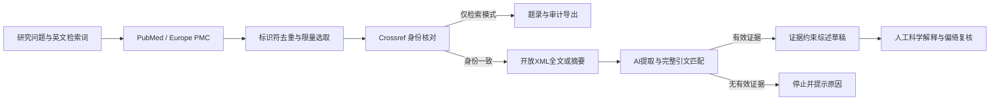

# BioMed 循证文献工作台

**AI + 生物医学研究：让文献综述中的每个论断都能回到来源。**

输入研究问题，实时查询公开文献，核对题录身份，再用模型提取原文证据并形成需要人工复核的综述草稿。没有有效证据时停止生成，余额不足或来源故障时明确暂停。

这是可独立启动的网页应用，包含真实后端；不是静态效果图，也不是原 Python 程序的完整移植。面向教学与小规模探索，不用于临床决策。

公开源码：[GitHub](https://github.com/Yiiiiihhhh/biomed-evidence-agent) · 在线体验：[魔搭创空间](https://modelscope.cn/studios/Yiiiiihhhh/biomed-evidence-agent)

## 评委从这里开始

1. 打开部署的网站，点击“填入示例”，选择 3 篇，再点 **免费检索与核验**。不需注册或模型密钥，会实际查询 PubMed / Europe PMC，再通过 Crossref 核对身份。
2. 点“引用核验”，填入 `AI in health and medicine`、第一作者 `Rajpurkar P`、年份 `2022`、DOI `10.1038/s41591-021-01614-0`。再把作者改成 `Zhang L` 对比。
3. 查看“质量与记录”和来源链接；检索不全、来源故障、年份差异都会显示，不能把“存疑”直接解释为假论文。
4. 若有可用 DeepSeek 密钥，打开模型设置。测试会发起一次短模型调用。填写后可运行“AI 阅读与综述”，按平台用量计费。密钥仅留在页面内存，刷新后需重填。
5. 导出证据 CSV、综述 Markdown 和审计 JSON。点击顶部“查看真实检索存档”可查看 2026-10-15 保存的公开接口结果；存档没有 AI 阅读或生成综述。

完整演示脚本见 [docs/demo.md](docs/demo.md)，参赛说明见 [docs/submission.md](docs/submission.md)。

## 工作原理



模型不生成参考文献记录。程序只从检索所得、身份确认且具有有效证据的文献集合渲染引用。原文匹配是文本检查，不能证明论断语义或因果解释正确。

## 独立运行

需要 Node.js 24+。安装 pnpm 后，在项目根目录运行：

```sh
npm install -g pnpm@11.25.0
pnpm install --frozen-lockfile
npm run build
npm start
```

浏览器访问 `http://localhost:7860`。运行时不需要安装 Python、Cloudflare、R2 或 ChatGPT 登录。配置通过系统环境变量传入；`.env.example` 只是说明文件，程序不会自动读取它。

Docker：

```sh
docker build -t biomed-evidence-agent .
docker run --rm -p 7860:7860 biomed-evidence-agent
```

以上不挂载持久目录的容器在删除后会丢失记录。长期运行应将可写目录挂载到 `/mnt/workspace/biomed`，确保容器的 `node` 用户有写权限。魔搭部署步骤见 [docs/deploy.md](docs/deploy.md)。

## 数据、密钥与费用

- 匿名空间使用服务端生成的 256 位随机会话。浏览器 `sessionStorage` 保存会话凭据，SQLite 只存凭据哈希。它不是实名账号，不支持跨设备找回。分享会话凭据会让接收者获得该空间访问权限。
- 刷新同一标签页可以继续；关闭标签页、清理浏览器或会话到期可能失去访问入口。会话最长 30 天，研究记录在最后更新 30 天后清理。重要成果应及时下载。
- SQLite 条件更新与步骤租约阻止同一版本的并发执行。默认每分钟全站最多 180 个 API 请求、单空间最多 45 个，同时最多 8 个请求；部署时需结合容量评估。
- 研究记录写入配置的数据目录。浏览器不能下载该目录、源码、密钥或数据库文件。API 不接受跨站写入。
- 使用 AI 时，用户输入、题录与选定原文片段经本网站服务端发送至 DeepSeek 官方接口。网站服务端会短暂处理密钥，但不会把它写入记录、日志或浏览器持久存储。
- 不提供共享付费密钥，不自动重试模型调用。免费检索没有模型费用；外部数据服务仍受各自可用性与使用规则限制。

## 验证

```sh
npm test
npm run test:routes
npm run build
npm run test:http
```

可选真实公开接口测试，**不调用模型**：

```sh
# Linux / macOS
BIOMED_LIVE_TEST=1 npm run test:http
# Windows PowerShell
$env:BIOMED_LIVE_TEST="1"
npm run test:http
```

已在 Windows / Node 24.19 完成构建、27 项核心与存储检查、21 个模拟路由场景，以及16项不依赖外网的HTTP检查。真实检索曾遇到两个公开来源同时超时，系统明确返回SEARCH_FAILED并保留任务。之后魔搭Docker构建及浏览器免费检索、正确引用与错误作者对照通过。模拟路由使用测试专用模型/来源 fixtures，不代表真实 AI 效果评测。见 [docs/testing.md](docs/testing.md)。GitHub CI 已配置，尚未在远端运行；真实付费 AI 阅读和多用户负载仍待验收。

## 当前边界

各来源最多获取 40 条，去重后按来源相关性顺序选取 1–10 篇，**不是系统综述的完整纳排流程**。缺少 DOI、字段冲突和关注声明会限制证据采用。长全文只读取部分文本并记录覆盖；无合法开放 XML 全文时使用摘要。暂不支持 PDF 上传、图表理解、自动 MeSH 核验、正式偏倚风险评价或后台无人值守队列。运行期间保持页面打开，暂停在当前步骤结束后生效。

## 来源与致谢

网页流程参考原 Biomedical Evidence Agent 的可追溯思路，界面与引用核验模块参考用户提供的课程项目。未复制原项目 `.env`、私密运行记录或 API 密钥。引用核验代码的来源与公开分发权利状态见 [PROVENANCE.md](PROVENANCE.md)。第三方依赖许可见 [THIRD_PARTY_NOTICES.md](THIRD_PARTY_NOTICES.md)。
